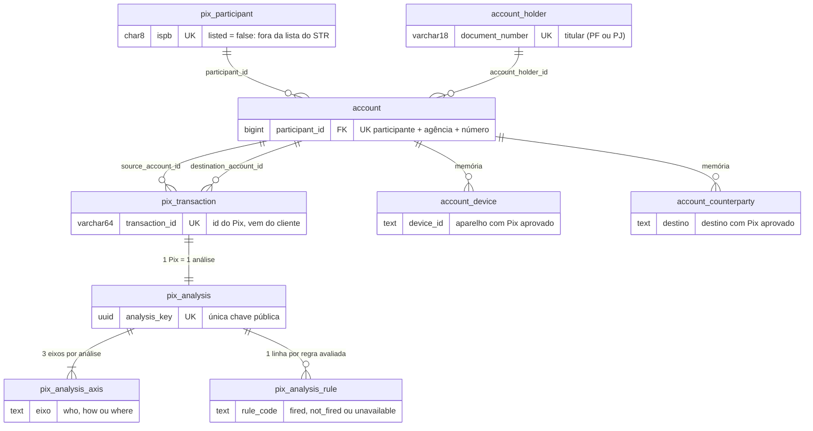

# Grupo 12 - RNV

**Integrantes:** Ramon Guimarães, Victoria Camile e Natalia Lugão

## Como o motor de decisão funciona

O motor antifraude de Pix do RNV recebe um Pix em `POST /pix/transaction` e decide `approved`, `two_factor_required` ou `rejected`, sempre com o motivo explicável em `metadata`. A análise é gravada e pode ser consultada depois em `GET /pix/transaction/{id}`. É um serviço único, chamado por outros serviços do RNV (como o de Transferências) com o header `INTERNAL-TOKEN`, nunca pelo cliente final.

### A tese: qual é a dúvida?

Não perguntamos "quão arriscado é este Pix". Perguntamos **qual é a dúvida**, porque a resposta define o que fazer com ele:

| Eixo | Dúvida | O 2FA resolve? | Consequência |
|---|---|---|---|
| **who** (device, canal, rede) | É o cliente mesmo? | Sim | Dúvida só aqui: pedir 2FA |
| **how** (valor, horário, comportamento do pagador) | Isso é normal para ele? | Sim | Dúvida só aqui: pedir 2FA |
| **where** (destino) | O dinheiro vai para golpe ou mula? | **Não** | Um segundo fator do pagador não muda quem recebe |

Por isso o `where` pesa mais: o 2FA confirma quem paga, não quem recebe.

### Como o motor está estruturado

- **Uma função pura no centro.** `evaluate(RiskContext) -> EngineResult`, em `src/engine/`, não acessa banco, não chama HTTP, não lê o relógio e não loga. Cada regra e cada célula da matriz é testada montando o contexto à mão, sem infraestrutura.
- **Um analisador por eixo.** `who`, `how` e `where` avaliam suas regras, e cada eixo sai `ok`, `suspicious` ou `critical`. Em volta deles ficam os pisos regulatórios e os sinais de confiança.
- **I/O só fora do motor.** O resource valida a forma do payload (JSON Schema, `400`). O controller valida o sentido (`422` ou `409`), grava titulares, contas e o Pix (o `UNIQUE` em `transaction_id` garante a idempotência), monta o `RiskContext` só com histórico anterior ao Pix, chama o motor e grava, numa única transação, a análise, todas as regras avaliadas e, se o Pix foi `approved`, a memória do motor. ISPB de destino fora da lista do STR não é erro: vira o sinal `WHERE_UNKNOWN_PARTICIPANT`.
- **Política em código, versionada.** Os parâmetros ficam em `src/engine/policy.py`, indexados por fluxo (`pf_pf`, `pf_pj`, `pj_pf`, `pj_pj`), sem número mágico nas regras. Toda mudança de parâmetro sobe `POLICY_VERSION`, e cada análise grava a versão e os limiares que usou, então qualquer decisão antiga pode ser reproduzida.

## Regras

Uma linha por regra que existe no código. **Regra** é o `rule_code` entre crases, o mesmo do `metadata`. **Parâmetros** traz os mesmos valores de `src/engine/policy.py`, com unidade em reais e dias (nunca centavos). **Por quê** justifica cada parâmetro: fonte regulatória, quando houver, ou a escolha de design e como foi calibrada.

| Regra | Lógica | Parâmetros | Por quê |
|---|---|---|---|
| `WHO_DEVICE_COMPROMISED` | Eixo `who`, `critical`. Dispara quando o device do Pix já foi usado por **3 ou mais titulares distintos** no total (contados por `account_holder`, ou seja, por documento) **ou** por **2 ou mais titulares distintos nas últimas 24 horas**; basta um dos dois gatilhos. A evidência vem de outra entidade (o device), e não da falta de histórico do pagador; por isso pode rejeitar a 1ª transação do cliente (`critical_axis`). Vale para todos os fluxos. | `DEVICE_COMPROMISED_DOCUMENTS_TOTAL` = 3<br>`DEVICE_COMPROMISED_DOCUMENTS_24H` = 2 | `DEVICE_COMPROMISED_DOCUMENTS_TOTAL`: escolha de design, sem norma por trás. Um aparelho compartilhado por vários titulares é o sinal clássico de aparelho de fraude ou de mula; o corte em 3 deixa de fora o uso legítimo de 2 titulares no mesmo aparelho (por exemplo, um casal), que é comum.<br>`DEVICE_COMPROMISED_DOCUMENTS_24H`: escolha de design. Uma rajada recente de titulares diferentes no mesmo aparelho é mais grave do que o acúmulo ao longo do tempo, por isso o corte é menor (2). A janela de 24h é a mesma do fan-in do destino.<br>É `critical` e não `suspicious` porque é dúvida de quem está usando o aparelho que o 2FA não resolve: o 2FA seria aprovado no próprio aparelho comprometido. Não foi calibrado ainda no simulador. |
| `HOW_NIGHT_LIMIT_EXCEEDED` | Eixo `how`, `suspicious`. Pix PF→PF entre titulares diferentes, feito no período noturno local do pagador, cuja soma (Pix anteriores aprovados ou em 2FA no mesmo período noturno, mais o Pix em análise) fica estritamente acima do limite. Pix às 02h soma desde as 20h do dia anterior. Self-Pix e fluxos PF→PJ, PJ→PF e PJ→PJ ficam de fora. | `NIGHT_START_HOUR` = 20h<br>`NIGHT_END_HOUR` = 6h<br>`NIGHT_LIMIT_MINOR[pf_pf]` = R$ 1.000 | `NIGHT_START_HOUR`, `NIGHT_END_HOUR`: janela noturna do Pix entre pessoas físicas, âncora regulatória do BCB (número da norma não citado: fonte primária ainda não conferida pelo time).<br>`NIGHT_LIMIT_MINOR[pf_pf]`: limite noturno regulatório entre pessoas físicas, o mesmo valor do piso `FLOOR_NIGHT_LIMIT`; estritamente acima, então R$ 1.000,00 exatos passam. Só vale para PF→PF porque o limite trata de pagamento entre pessoas; comércio noturno (PF→PJ) e folha (PJ) são normais, e o self-Pix não é pagamento a terceiro. |
| `HOW_VELOCITY_EXCEEDED` | Eixo `how`. Dispara pelo número de tentativas do pagador nos últimos 10 minutos, **contando todos os status** (`approved`, `two_factor_required` e `rejected`: insistência é sinal). Chegou ao limite `suspicious`, a regra marca `suspicious`; chegou ao limite `critical`, marca `critical`. Os limites são por fluxo: PF paga em poucas tentativas, PJ envia em lote (folha de pagamento). | `VELOCITY_WINDOW_MINUTES` = 10<br>`VELOCITY_10MIN[pf_pf].suspicious` = 3<br>`VELOCITY_10MIN[pf_pf].critical` = 6<br>`VELOCITY_10MIN[pf_pj].suspicious` = 3<br>`VELOCITY_10MIN[pf_pj].critical` = 6<br>`VELOCITY_10MIN[pj_pf].suspicious` = 20<br>`VELOCITY_10MIN[pj_pf].critical` = 40<br>`VELOCITY_10MIN[pj_pj].suspicious` = 20<br>`VELOCITY_10MIN[pj_pj].critical` = 40 | `VELOCITY_WINDOW_MINUTES`: escolha de design; 10 minutos é curto o bastante para pegar rajada e longo o bastante para uma pessoa legítima não chegar ao limite por acaso.<br>`VELOCITY_10MIN` para PF: escolha de design, sem norma por trás. Uma pessoa física raramente faz 3 Pix em 10 minutos, então 3 já pede 2FA (dúvida de comportamento, que o 2FA resolve); 6 é o dobro e indica automação, por isso `critical`.<br>`VELOCITY_10MIN` para PJ: 20 e 40, porque empresa paga em lote (folha de pagamento) e o corte de PF geraria falso positivo; o `critical` é o dobro do `suspicious`, a mesma proporção do PF (decisão D4 do time). Não foi calibrado ainda no simulador. |
| `FLOOR_UNREGISTERED_DEVICE` | Piso regulatório (eixo `floor`, sem nível): pagador PF com device sem histórico (`unknown`) dispara por **dois gatilhos**: (1) valor do Pix acima do limite por transação; ou (2) soma do dia-calendário local do pagador naquele device (Pix anteriores `approved` e `two_factor_required`, mais o Pix em análise) acima do limite diário. Garante no mínimo `two_factor_required` (`regulatory_floor`); sozinho nunca rejeita, a rejeição vinda de outros eixos prevalece, e a confiança não o remove. | `UNKNOWN_DEVICE_TX_LIMIT_MINOR[pf_pf]` = R$ 200<br>`UNKNOWN_DEVICE_TX_LIMIT_MINOR[pf_pj]` = R$ 200<br>`UNKNOWN_DEVICE_DAILY_LIMIT_MINOR[pf_pf]` = R$ 1.000<br>`UNKNOWN_DEVICE_DAILY_LIMIT_MINOR[pf_pj]` = R$ 1.000 | `UNKNOWN_DEVICE_TX_LIMIT_MINOR`: limite por transação para dispositivo não cadastrado, parâmetro regulatório do Pix; estritamente acima, então R$ 200,00 exatos passam.<br>`UNKNOWN_DEVICE_DAILY_LIMIT_MINOR`: limite diário para dispositivo não cadastrado, parâmetro regulatório do Pix; pega o fracionamento em vários Pix pequenos, e o "dia" é o dia-calendário local porque a regra é por dia, não por 24h corridas. Estritamente acima, então R$ 1.000,00 exatos passam.<br>Os dois só valem com pagador PF (PF→PF e PF→PJ). Device `observing` ou `trusted` já tem histórico e não aciona o piso. O número da norma não é citado: a fonte primária ainda não foi conferida pelo time. |
| `FLOOR_NIGHT_LIMIT` | Piso regulatório (eixo `floor`, sem nível): PF→PF entre titulares diferentes, no período noturno local, com soma (incluindo o Pix em análise) estritamente acima do limite. Garante no mínimo `two_factor_required` (`regulatory_floor`); nunca suaviza um `rejected`, e a confiança não o remove. | `NIGHT_START_HOUR` = 20h<br>`NIGHT_END_HOUR` = 6h<br>`NIGHT_LIMIT_MINOR[pf_pf]` = R$ 1.000 | Mesmos parâmetros e mesma fonte de `HOW_NIGHT_LIMIT_EXCEEDED`. A soma conta Pix `approved` e `two_factor_required` (tudo que pode ter saído). A regra do eixo `how` e o piso coexistem: o piso é a garantia regulatória, a regra é o sinal que entra na matriz. |
| `WHERE_DESTINATION_NEW_ACCOUNT` | Eixo `where`, `suspicious`. Dispara quando a conta de destino foi aberta há **menos** de 30 dias na data do Pix (estritamente abaixo: 29 dias dispara, 30 não). Vale para todos os fluxos. | `DESTINATION_NEW_ACCOUNT_DAYS` = 30 dias | `DESTINATION_NEW_ACCOUNT_DAYS`: escolha de design, sem norma por trás. Conta recém-aberta é o destino típico de golpe e de mula, e o 2FA não resolve dúvida de destino (eixo `where`). Os 30 dias são o mesmo corte de "destino jovem" usado em `WHERE_DESTINATION_FAN_IN` e no self-Pix maduro (`MATURE_SELF_PIX_MIN_DESTINATION_AGE_DAYS`), para as regras não se contradizerem. Sozinha só pede 2FA; vira `rejected` quando outro eixo também está suspeito (matriz). |
| `WHERE_UNKNOWN_PARTICIPANT` | Eixo `where`, `suspicious`. Dispara quando o ISPB do participante de destino não está na Relação de participantes do STR carregada no banco (`listed = false`). Não é erro de entrada: o Pix é analisado normalmente e o participante é criado como não listado. Vale para todos os fluxos. | Sem parâmetro numérico. Referência: a lista do STR (BCB, 16/10/2026) | Destino fora da lista oficial é dúvida sobre o destino, que o 2FA não resolve, por isso é sinal e não rejeição direta: um ISPB legítimo recém-criado ou ausente da nossa cópia da lista não pode derrubar o Pix sozinho. Não há limiar a calibrar; o dado vem da tabela de referência `pix_participant`. |
| `WHERE_DESTINATION_FAN_IN` | Eixo `where`, `critical`. Conta de destino aberta há **menos** de 30 dias que recebeu de pelo menos N pagadores distintos nas últimas 24h, contando todas as tentativas (aprovadas, em 2FA e rejeitadas). N depende do fluxo. Destino com 30 dias ou mais fica de fora. Como a evidência vem do destino (outra entidade), pode rejeitar a 1ª transação do pagador. | `FAN_IN_CRITICAL_PAYERS_24H[pf_pf]` = 3<br>`FAN_IN_CRITICAL_PAYERS_24H[pj_pf]` = 3<br>`FAN_IN_CRITICAL_PAYERS_24H[pf_pj]` = 10<br>`FAN_IN_CRITICAL_PAYERS_24H[pj_pj]` = 10<br>`FAN_IN_WINDOW_HOURS` = 24<br>`DESTINATION_NEW_ACCOUNT_DAYS` = 30 | `FAN_IN_CRITICAL_PAYERS_24H`: quando o destino é pessoa física, 3 pagadores distintos em 24h numa conta recém-aberta já é padrão de mula. Quando é pessoa jurídica, o limite sobe para 10 porque loja nova recebe de muitos clientes, mas uma falsa loja recebe de muitos mais. É `critical` porque o 2FA não resolve dúvida de destino. Os valores são escolha de design, sem norma por trás.<br>`FAN_IN_WINDOW_HOURS`: a campanha de golpe aparece nas tentativas recentes, por isso a janela é curta e conta todos os status.<br>`DESTINATION_NEW_ACCOUNT_DAYS`: o mesmo corte de `WHERE_DESTINATION_NEW_ACCOUNT`. |
| `WHERE_DESTINATION_REJECTIONS` | Eixo `where`, `critical`. Destino com rejeições de pelo menos 2 pagadores distintos nas últimas 24h (o mesmo pagador rejeitado várias vezes conta uma vez). Vale para todos os fluxos e para destino de qualquer idade. Como a evidência vem do destino (outra entidade), pode rejeitar a 1ª transação do pagador. | `DESTINATION_REJECTIONS_CRITICAL_PAYERS_24H` = 2<br>`FAN_IN_WINDOW_HOURS` = 24 | `DESTINATION_REJECTIONS_CRITICAL_PAYERS_24H`: é a "fundada suspeita" da Res. BCB 501/2025, como registrado no CLAUDE.md do projeto (texto da norma ainda não conferido pelo time na fonte primária). Duas rejeições de pagadores diferentes tiram a dúvida de que seja um erro isolado de um cliente. Só conta `rejected`, não 2FA.<br>`FAN_IN_WINDOW_HOURS`: a mesma janela de 24h do fan-in. |
| `HOW_ABOVE_CUSTOMER_CEILING` | Eixo `how`, `suspicious`. Dispara quando o valor do Pix fica estritamente acima do **teto do cliente**. O teto mistura o histórico do pagador com um teto de referência: `teto = (n × teto_hist + K × teto_ref) / (n + K)`, com `n` = Pix aprovados do pagador nos últimos 90 dias e `K` = peso do teto de referência. `teto_hist` = `HISTORY_MARGIN` × percentil 95 (interpolação linear entre os valores ordenados) dos valores aprovados. `teto_ref` depende do pagador: PF com conta de origem aberta há menos de 90 dias, PF com 90 dias ou mais, ou PJ. Sem Pix aprovado (fase 0 do pagador), `n` = 0 e vale só o `teto_ref`: a ausência de histórico nunca é evidência, então a 1ª transação só dispara se passar do teto de referência. Conforme `n` cresce o teto passa a seguir o comportamento do próprio cliente (fases 1 e 2). O teto é truncado para centavos inteiros. Vale para todos os fluxos. | `REFERENCE_CEILING_NEW_ACCOUNT_DAYS` = 90 dias<br>`REFERENCE_CEILING_MINOR.individual_new_account` = R$ 1.000<br>`REFERENCE_CEILING_MINOR.individual` = R$ 3.000<br>`REFERENCE_CEILING_MINOR.company` = R$ 20.000<br>`HISTORY_WINDOW_DAYS` = 90 dias<br>`HISTORY_PERCENTILE` = 0,95<br>`HISTORY_MARGIN` = 1,5<br>`SHRINKAGE_K` = 5 | `REFERENCE_CEILING_MINOR`: escolha de design, sem norma por trás (o R$ 1.000 não vem de resolução do BCB). É um ponto de partida conservador para quem ainda não tem histórico: conta de PF com menos de 90 dias tem teto menor porque a conta nova é o perfil de conta de passagem; PF com 90 dias ou mais tem R$ 3.000, acima do Pix de R$ 1.500 do payload do desafio, para a 1ª transação de um cliente comum não ser tocada; PJ tem R$ 20.000 porque pagamentos de empresa são maiores por natureza. Não foi calibrado ainda no simulador.<br>`REFERENCE_CEILING_NEW_ACCOUNT_DAYS`: escolha de design; 90 dias é a janela de histórico da política, então uma conta que já completou a janela é tratada como estabelecida.<br>`HISTORY_WINDOW_DAYS`: 90 dias é o limite de consulta no caminho síncrono (índice + intervalo de data), e cobre ciclos mensais de gasto.<br>`HISTORY_PERCENTILE`: o p95 ignora o valor atípico raro do próprio cliente sem deixar o teto subir até o maior Pix já feito.<br>`HISTORY_MARGIN`: 1,5 dá folga de 50% sobre o p95 para que variação normal de gasto não dispare; escolha de design, sem calibração ainda.<br>`SHRINKAGE_K`: 5 equivale a dizer que o teto de referência pesa como 5 Pix aprovados; com poucos Pix o teto ainda é quase o de referência, com 5 aprovados já pesa meio a meio e depois o histórico passa a dominar. É o mesmo 5 que define a fase 2 do pagador (5 aprovados e 30 dias). Dúvida de comportamento (`how`) que o 2FA resolve, por isso `suspicious` e nunca `critical`. |
| `HOW_EARLY_MORNING_AMOUNT` | Eixo `how`, `suspicious`. Dispara quando o Pix é feito de madrugada no horário local do pagador (00:00 a 05:59, a hora local vem de `transaction_date` + `utc_offset_minutes`) e o valor está **estritamente acima** do mínimo e **até** o máximo da faixa (R$ 200,00 exatos não disparam; R$ 1.000,00 exatos disparam). Acima do máximo a regra não atua: PF→PF entre titulares diferentes já cai no limite noturno (`HOW_NIGHT_LIMIT_EXCEEDED`). Vale para todos os fluxos e não depende de histórico do pagador (o sinal está no próprio Pix). | `EARLY_MORNING_START_HOUR` = 0h<br>`EARLY_MORNING_END_HOUR` = 6h<br>`EARLY_MORNING_MIN_AMOUNT_MINOR` = R$ 200<br>`EARLY_MORNING_MAX_AMOUNT_MINOR` = R$ 1.000 | `EARLY_MORNING_START_HOUR`, `EARLY_MORNING_END_HOUR`: escolha de design, sem norma por trás; madrugada é a faixa em que o uso legítimo é raro, então um valor médio ali foge do padrão da maioria dos clientes (hipótese, ainda não medida no simulador); a janela é mais curta que a janela noturna regulatória (20h às 6h) de propósito, para o sinal ser mais específico.<br>`EARLY_MORNING_MIN_AMOUNT_MINOR`: escolha de design; abaixo de R$ 200 o dano é pequeno e o valor é comum em madrugada (táxi, lanche). Usa o mesmo número do limite de dispositivo não cadastrado só por coerência de ordem de grandeza, e tem parâmetro próprio para poder ser calibrado sozinho.<br>`EARLY_MORNING_MAX_AMOUNT_MINOR`: escolha de design; R$ 1.000 é o limite noturno regulatório entre pessoas físicas, então acima disso o sinal já existe em outra regra e o piso regulatório cobre. É dúvida de comportamento (`how`) que o 2FA resolve, por isso `suspicious`. Não foi calibrado ainda no simulador. |
| `WHO_DEVICE_UNKNOWN` | Eixo `who`, `suspicious`. Dispara quando o device do Pix não tem nenhum Pix aprovado do pagador (estado `unknown`) **e** o pagador já tem pelo menos um outro device com Pix aprovado. Pagador sem nenhum device conhecido (1ª transação, ou só histórico sem aprovação) não dispara: ausência de histórico nunca é evidência, então o 1º device de um cliente não vira dúvida. O estado do device é `unknown` (sem aprovado), `observing` (aprovado, mas o primeiro aprovado tem 24h ou menos) ou `trusted` (aprovado há mais de 24h); só `unknown` dispara. É uma regra de sinal, independente do piso `FLOOR_UNREGISTERED_DEVICE`: o piso garante o 2FA por valor, esta regra entra na matriz e, somada a outro eixo suspeito, rejeita. Vale para todos os fluxos. | `DEVICE_UNKNOWN_MIN_KNOWN_DEVICES` = 1<br>`DEVICE_TRUSTED_AFTER_HOURS` = 24h | `DEVICE_UNKNOWN_MIN_KNOWN_DEVICES`: escolha de design. Um cliente que sempre usou outro aparelho e aparece num aparelho novo é dúvida de identidade (`who`), que o 2FA resolve; com 0 devices conhecidos não há contra o que comparar, por isso o mínimo é 1 e a 1ª transação fica `ok`.<br>`DEVICE_TRUSTED_AFTER_HOURS`: escolha de design; um device aprovado há mais de 24h deixa de ser novo, e a espera impede que um fraudador ganhe confiança com um único Pix aprovado e use o device logo em seguida. Não foi calibrado ainda no simulador.<br>Consequência para quem chama o serviço e para os cenários de teste: o mesmo pagador precisa mandar sempre o mesmo `device_id`. Trocar de device a cada Pix, depois de já ter histórico, dispara esta regra (um gerador de payload que sorteia um device novo por Pix faz um pagador legítimo parecer suspeito). |
| `WHO_AGGRAVATING_SIGNALS` | Eixo `who`, `suspicious`. Dispara quando ocorrem **2 ou mais sinais agravantes** do eixo `who` no Pix em análise. Agravantes avaliados: (1) IP com 5 ou mais pagadores distintos na última 1h (`ip.distinct_payers_1h`); (2) IP privado (`transaction.ip_is_private`: faixas RFC 1918, loopback e link-local; o IP do desafio 198.51.100.23 NÃO é privado); (3) canal novo para o pagador (`transaction.channel` fora de `known_channels`, avaliado apenas quando o pagador já possui histórico aprovado; ausência de histórico nunca é evidência). Um único agravante isolado mantém o eixo `who` em `ok`; 2 ou mais agravantes marcam `suspicious`. Vale para todos os fluxos. | `WHO_AGGRAVATING_MIN_SIGNALS` = 2<br>`WHO_AGGRAVATING_IP_DISTINCT_PAYERS_1H` = 5 | `WHO_AGGRAVATING_MIN_SIGNALS`: escolha de design. Um único sinal técnico isolado (ex.: estar em Wi-Fi com IP privado ou em um quiosque/NAT compartilhado) pode ser legítimo; a combinação de 2 ou mais agravantes simultâneos remove a dúvida fortuita e indica risco de canal/rede, pedindo 2FA (dúvida de identidade, que o 2FA resolve).<br>`WHO_AGGRAVATING_IP_DISTINCT_PAYERS_1H`: escolha de design; 5 pagadores diferentes num mesmo IP em 1h indica infraestrutura compartilhada atípica ou ataque distribuído.<br>IP privado: RFC 1918 (10/8, 172.16/12, 192.168/16), loopback e link-local. O IP do desafio (198.51.100.23, faixa de documentação TEST-NET-2) não está nessas faixas, então não conta como privado.<br>Canal novo: só avaliado para pagadores com histórico (fase 1 ou 2), garantindo que clientes em cold start não sofram penalização. |
| `HOW_RETRY_AFTER_REJECTION` | Eixo `how`, `suspicious`. É a "sondagem": o pagador teve um Pix `rejected` e, em **menos de** 10 minutos, tenta de novo com valor **estritamente menor** que o rejeitado. A rejeição considerada é a mais recente do mesmo pagador (conta de origem) nos últimos 90 dias. Valor igual ou maior, ou nova tentativa com 10 minutos ou mais, não dispara. Sem rejeição anterior a regra não atua (sem histórico, nunca é evidência). Vale para todos os fluxos. | `RETRY_AFTER_REJECTION_WINDOW_MINUTES` = 10 | `RETRY_AFTER_REJECTION_WINDOW_MINUTES`: escolha de design, sem norma por trás; é o mesmo horizonte de 10 minutos da velocity (`VELOCITY_WINDOW_MINUTES`), curto o bastante para ligar a nova tentativa à rejeição sem pegar um cliente que desistiu e voltou depois. Reduzir o valor depois de uma rejeição é o comportamento de quem testa o limite do antifraude; a rejeição do motor é o rótulo aproximado de fraude que temos (não há confirmação externa), por isso o sinal é `suspicious` e não `critical`: dúvida de comportamento, que o 2FA resolve. Não foi calibrado ainda no simulador. |
| `HOW_TEST_PIX` | Eixo `how`, `suspicious`. É o "Pix de teste": o pagador mandou, nos últimos 15 minutos, um Pix de até R$ 10 (qualquer status) ao **mesmo destino**, e agora manda um Pix de pelo menos R$ 200 e de pelo menos 20 vezes o valor do teste a esse destino. Não dispara se o destino já era conhecido antes do teste, isto é, se existe Pix aprovado do pagador a esse destino anterior à janela de 15 minutos (o próprio Pix de teste, quando aprovado, não cria essa relação). O histórico (Pix pequeno no destino, já com o fator de 20 vezes aplicado ao valor atual) é calculado na consulta do resumo do pagador; o motor combina com o valor mínimo e com a relação anterior com o destino. Com os valores atuais, 20 vezes o teto de R$ 10 é exatamente o mínimo de R$ 200. Vale para todos os fluxos. | `TEST_PIX_MAX_AMOUNT_MINOR` = R$ 10<br>`TEST_PIX_WINDOW_MINUTES` = 15<br>`TEST_PIX_FOLLOWUP_MIN_AMOUNT_MINOR` = R$ 200<br>`TEST_PIX_FOLLOWUP_MULTIPLIER` = 20 | `TEST_PIX_MAX_AMOUNT_MINOR`: escolha de design, sem norma por trás; golpista que testa se a conta recebe e se o dono não percebe costuma mandar valor simbólico, e R$ 10 deixa de fora Pix pequenos legítimos acima disso.<br>`TEST_PIX_WINDOW_MINUTES`: escolha de design; o teste e o Pix grande vêm juntos, e 15 minutos cobre o intervalo de quem espera a confirmação antes de mandar o valor real.<br>`TEST_PIX_FOLLOWUP_MIN_AMOUNT_MINOR`: escolha de design; abaixo de R$ 200 o Pix seguinte não compensa a investigação e coincide com a ordem de grandeza do piso de device não cadastrado.<br>`TEST_PIX_FOLLOWUP_MULTIPLIER`: escolha de design; exigir um salto de 20 vezes separa o teste real do cliente que paga duas contas pequenas ao mesmo destino. É dúvida de comportamento (`how`) que o 2FA resolve, por isso `suspicious`. Não foi calibrado ainda no simulador. |
| `TRUST_RECURRENT_BENEFICIARY` | Sinal de confiança (eixo `trust`, sem nível). Dispara quando o pagador já tem **2 ou mais Pix aprovados** para a mesma conta de destino **e** o primeiro deles foi aprovado **mais de 24h** antes do Pix em análise (24h exatas não bastam). Só conta `approved`; o dado vem da memória `account_counterparty` (consulta pontual pela chave do par, sem janela de 90 dias). Quando dispara, rebaixa **um** eixo `suspicious` para `ok`, na ordem who → how → where; nunca rebaixa um `critical` e nunca remove um piso regulatório. Se o rebaixamento muda a decisão, o `decision_basis` é `trust_downgrade` e o código aparece em `trust` no `metadata`. | `RECURRENT_BENEFICIARY_MIN_APPROVED` = 2<br>`RECURRENT_BENEFICIARY_MIN_AGE_HOURS` = 24h | `RECURRENT_BENEFICIARY_MIN_APPROVED`: escolha de design, sem norma por trás. Dois pagamentos aprovados mostram uma relação anterior a este Pix; um só pode ser o próprio golpe que passou.<br>`RECURRENT_BENEFICIARY_MIN_AGE_HOURS`: escolha de design. As 24h impedem o golpista de "fabricar" recorrência com dois Pix seguidos na mesma sessão: a relação precisa ter nascido antes do dia do ataque. Não foi calibrado ainda no simulador. |
| `TRUST_MATURE_SELF_PIX` | Sinal de confiança (eixo `trust`, sem nível). Dispara quando as duas pontas são do **mesmo titular** (`account_holder`), a conta de destino foi aberta há **30 dias ou mais** (29 não basta) **e** o device do Pix é `trusted`. Não exige histórico entre as duas contas. Mesmo efeito do destinatário recorrente: rebaixa **um** eixo `suspicious` (who → how → where), nunca um `critical`, nunca um piso. | `MATURE_SELF_PIX_MIN_DESTINATION_AGE_DAYS` = 30 dias | `MATURE_SELF_PIX_MIN_DESTINATION_AGE_DAYS`: escolha de design, sem norma por trás. O risco do self-Pix é a conta fantasma recém-aberta no nome da vítima; 30 dias é o mesmo corte de destino jovem de `WHERE_DESTINATION_NEW_ACCOUNT`, para as regras não se contradizerem. O device `trusted` garante que é o cliente de sempre movendo o próprio dinheiro. Exigir histórico entre as contas puniria o primeiro Pix legítimo para a própria conta antiga. |

### Por que estas regras

Cada regra responde a uma das três dúvidas da tese e entrou por um de três motivos:

- **Âncora regulatória.** O limite noturno entre pessoas físicas (`HOW_NIGHT_LIMIT_EXCEEDED` e o piso `FLOOR_NIGHT_LIMIT`), o limite de dispositivo não cadastrado (`FLOOR_UNREGISTERED_DEVICE`) e a rejeição por "fundada suspeita" no destino (`WHERE_DESTINATION_REJECTIONS`). São os únicos números com origem em norma.
- **Padrões de golpe conhecidos, cada um no eixo da sua dúvida.** Conta de destino recém-aberta e destino que recebe de muitos pagadores (mula, falsa loja), aparelho usado por vários titulares, rajada de tentativas, Pix de teste antes do valor alto, nova tentativa menor logo depois de uma rejeição (sondagem), valor acima do padrão do próprio cliente, valor médio de madrugada e sinais de rede (IP compartilhado, IP privado, canal novo).
- **Não punir quem já provou a relação.** Destinatário recorrente e Pix maduro para a própria conta rebaixam uma dúvida, para o cliente de sempre não pagar 2FA à toa.

O nível de cada regra segue a tese. Dúvida que o 2FA resolve (identidade e comportamento) é `suspicious`. Evidência forte, que o 2FA não resolve, é `critical`: aparelho comprometido, fan-in em conta nova e rejeições no destino. Nenhuma regra trata a falta de histórico do pagador como evidência: as que comparam com o histórico só comparam quando ele existe, e sem histórico o teto do cliente é o teto de referência. Fora os números regulatórios, os parâmetros são escolhas de design, ajustadas por fluxo e por idade de conta. O simulador de personas (`scripts/farm.py`) confere que as personas legítimas terminam com 0 rejeições e no máximo 10% de 2FA, mas nenhum parâmetro foi calibrado com dados reais.

## Como as regras viram decisão

Cada regra avaliada marca um dos três eixos (`who`, `how`, `where`) com um nível: `ok`, `suspicious` ou `critical`. O nível final de cada eixo é o mais grave entre suas regras.

### Ordem de avaliação

1. Cada analisador (`who`, `how`, `where`) avalia todas as suas regras. O eixo fica com o nível mais grave entre as regras que dispararam, ou `ok` se nenhuma disparou.
2. Os sinais de confiança, se houver, rebaixam **um** eixo `suspicious` para `ok`, na ordem `who` → `how` → `where`. Um `critical` nunca é rebaixado.
3. A matriz decide a partir dos três níveis (tabela abaixo).
4. Por último, os pisos regulatórios: se a matriz deu `approved` e algum piso disparou, a decisão sobe para `two_factor_required`. Um piso nunca suaviza uma rejeição.
5. O `metadata` registra a base da decisão (`decision_basis`), os motivos, os pisos e o sinal de confiança aplicado. Toda regra avaliada, inclusive as que não dispararam, é gravada em `pix_analysis_rule`.

### Quando pede 2FA

O resultado é `two_factor_required` em três casos, sempre sem nenhum eixo `critical`:

- exatamente **um** eixo `suspicious` (`single_suspicious_axis`);
- dois eixos `suspicious`, e um sinal de confiança rebaixou um deles (`trust_downgrade`);
- nenhum eixo em dúvida, mas um piso regulatório disparou (`regulatory_floor`): device sem histórico com Pix acima de R$ 200 ou mais de R$ 1.000 no dia, ou PF→PF noturno somando mais de R$ 1.000.

### A matriz dos 3 eixos

| Situação | Decisão | `decision_basis` |
|---|---|---|
| Algum eixo `critical` | `rejected` | `critical_axis` |
| 2 ou mais eixos `suspicious` | `rejected` | `two_suspicious_axes` |
| 1 eixo `suspicious` | `two_factor_required` | `single_suspicious_axis` |
| Todos `ok` | `approved` | `clean` |

Dois eixos em dúvida significam que o 2FA, que só resolve a dúvida de um deles, não basta. Os outros valores de `decision_basis` são `regulatory_floor` (decisão imposta por piso regulatório) e `trust_downgrade` (decisão alterada por sinal de confiança).

### Pisos regulatórios

Mínimo `two_factor_required`, independentemente do restante:

- Device sem histórico e valor acima de R$ 200 (`FLOOR_UNREGISTERED_DEVICE`).
- PF→PF noturno (20h às 6h) somando mais de R$ 1.000.

São os únicos limites com origem regulatória. Os demais números da política são escolhas de design, ajustadas por fluxo e por idade de conta, e o teto do cliente acompanha o histórico dele. Os valores exatos de cada regra estão na tabela de Regras; número de norma só é citado com a fonte primária conferida.

### Sinais de confiança

Destinatário recorrente, ou Pix para si mesmo (self-Pix) maduro com device confiável, rebaixa **um** eixo `suspicious` para `ok`. Um `critical` nunca é rebaixado. A confiança rebaixa primeiro a dúvida que ela resolve (quem e como), não a de destino, então a ordem é **who → how → where**: com `who` e `where` em `suspicious`, o `who` vira `ok`, o `where` continua `suspicious` e a decisão é `two_factor_required`; só com `where` em `suspicious`, o `where` é rebaixado. O sinal aparece em `trust` (por exemplo `TRUST_RECURRENT_BENEFICIARY`).

### Cold start: ausência de histórico nunca é evidência

- Device novo só é suspeito se o pagador já tem outros devices.
- A primeira transação só é rejeitada por evidência do próprio payload em 2 eixos, ou por histórico de **outra** entidade (device, destino ou IP).
- Cliente sem histórico nunca é rejeitado só por ser novo.

### Fases do pagador

| Fase | Critério | Efeito |
|---|---|---|
| 0 | 0 aprovadas | usa o teto de referência |
| 1 | 1 a 4 aprovadas | mistura teto histórico e de referência |
| 2 | 5+ aprovadas e 30+ dias | predomina o teto histórico |

Teto do cliente = (n · teto_hist + 5 · teto_ref) / (n + 5), onde n é o número de Pix aprovados. O device evolui de `unknown` para `observing` e para `trusted` (1+ aprovada e primeira vez há mais de 24h). Device usado por 3 ou mais documentos é comprometido (`critical`).

### O que conta em cada consulta

| Uso | Status considerados | Por quê |
|---|---|---|
| Somas de limite (noturno, diário de device novo) | `approved` + `two_factor_required` | Conservador: tudo que PODE ter saído |
| Velocity (tentativas) | todos | Insistência é sinal |
| Fan-in do destino (pagadores distintos) | todos | Campanha aparece nas tentativas |
| Device compartilhado (titulares distintos, 90 dias e 24h) | todos | Uso por vários titulares aparece nas tentativas; não conta o pagador atual |
| Rejeições no destino | `rejected` | "Fundada suspeita" (Res. BCB 501/2025) |
| Teto do cliente, device confiável, destinatário recorrente | `approved` | Conservador: só o que CERTAMENTE saiu |

### Racional de custo esperado

É a justificativa teórica da matriz, não um cálculo em runtime (não temos a probabilidade de fraude). Quando a dúvida é de identidade (`who`, `how`), o 2FA resolve e custa pouco, então ele domina a rejeição. Quando a dúvida é do destino (`where`), o 2FA não resolve, então rejeitar domina.

### Exemplo de ponta a ponta

#### 1. O payload do desafio vira `rejected`

Pix de R$ 1.500,00 de pessoa física para pessoa física, às 22h15 (-03:00), de uma conta aberta em março de 2025 para uma conta aberta em 10/10/2026. O mesmo arquivo está em `tests/fixtures/challenge_example_payload.json`.

```bash
curl -s -X POST http://localhost:8001/pix/transaction \
  -H "Content-Type: application/json" \
  -H "INTERNAL-TOKEN: internal-token-dev" \
  -d '{
    "id": "pix-000123",
    "amount": 150000,
    "transaction_date": "2026-10-17T22:15:00-03:00",
    "source_account": {
      "branch": "0001",
      "account_number": "88213",
      "opening_date": "2025-03-02T10:00:00-03:00",
      "owner": { "document_number": "123.456.789-09" }
    },
    "destination_account": {
      "participant": "60701190",
      "branch": "3675",
      "account_number": "10442",
      "opening_date": "2026-10-10T09:00:00-03:00",
      "owner": { "document_number": "987.654.321-00" }
    },
    "source": {
      "device_id": "dvc-9f2c71a8",
      "channel": "app",
      "ip": "198.51.100.23",
      "geolocation": { "latitude": -23.56, "longitude": -46.65 }
    }
  }'
```

Resposta `201` (o `key` muda a cada análise; o corpo está reformatado para leitura):

```json
{
  "key": "0b7f3c52-6c1e-4d0a-9a39-5d3c1f7e2a10",
  "status": "rejected",
  "metadata": {
    "policy_version": "2026.10.18-1",
    "flow": "pf_pf",
    "payer_maturity_phase": 0,
    "decision_basis": "two_suspicious_axes",
    "axes": { "who": "ok", "how": "suspicious", "where": "suspicious" },
    "reasons": [
      {
        "code": "HOW_NIGHT_LIMIT_EXCEEDED",
        "axis": "how",
        "level": "suspicious",
        "observed": { "night_amount": 150000 },
        "threshold": { "night_amount": 100000 },
        "description": "Night-time amount between individuals above R$ 1,000.",
        "translation": "Soma noturna entre pessoas físicas acima de R$ 1.000."
      },
      {
        "code": "WHERE_DESTINATION_NEW_ACCOUNT",
        "axis": "where",
        "level": "suspicious",
        "observed": { "destination_account_age_days": 7.55 },
        "threshold": { "destination_account_age_days": 30 },
        "description": "Destination account opened less than 30 days ago.",
        "translation": "Conta de destino aberta há menos de 30 dias."
      }
    ],
    "floors": ["FLOOR_UNREGISTERED_DEVICE", "FLOOR_NIGHT_LIMIT"],
    "trust": []
  }
}
```

Por que `rejected`, campo a campo:

- **`flow: pf_pf`**: os dois documentos são CPF (formato `000.000.000-00`), então a política usada é a de pessoa física para pessoa física.
- **`HOW_NIGHT_LIMIT_EXCEEDED` (eixo `how`)**: 22h15 no fuso do pagador (`-03:00`) está dentro da janela noturna de 20h às 6h. A soma noturna é R$ 1.500,00 (nenhum Pix anterior mais este) e o limite entre pessoas físicas é R$ 1.000,00. `observed` e `threshold` estão em centavos (`150000` e `100000`). O eixo `how` vira `suspicious`: é dúvida de comportamento, que um 2FA resolveria.
- **`WHERE_DESTINATION_NEW_ACCOUNT` (eixo `where`)**: a conta de destino foi aberta em 10/10/2026 às 09h; o Pix é de 17/10/2026 às 22h15, ou seja, 7 dias e 13h15 depois (7,55 dias), abaixo dos 30 dias do limite. O eixo `where` vira `suspicious`. Essa dúvida é sobre quem recebe, e o 2FA do pagador não a resolve.
- **`decision_basis: two_suspicious_axes`**: dois eixos em dúvida (`how` e `where`) levam a `rejected` pela matriz. O `who` está `ok`: o device nunca foi usado por outro titular, e device novo, sozinho, não é evidência.
- **`floors`**: os dois pisos regulatórios também dispararam (device sem histórico com Pix acima de R$ 200; soma noturna entre pessoas físicas acima de R$ 1.000). Um piso só garante no mínimo `two_factor_required` e nunca rejeita sozinho; aqui a rejeição já vem da matriz, e a lista fica no `metadata` para auditoria.
- **`payer_maturity_phase: 0` e `trust: []`**: o pagador não tem nenhum Pix aprovado, e não há sinal de confiança que rebaixe a dúvida.
- **Por que o cold start não impede a rejeição**: ausência de histórico nunca é evidência, e aqui não é ela que decide. As duas evidências vêm do próprio payload (valor e horário, e idade da conta de destino), em dois eixos diferentes.

#### 2. Pix limpo: `approved`

Pix de R$ 50,00 em horário comercial, de pessoa física para pessoa física, com conta de destino aberta há mais de um ano e sem histórico de problema.

```bash
curl -s -X POST http://localhost:8001/pix/transaction \
  -H "Content-Type: application/json" \
  -H "INTERNAL-TOKEN: internal-token-dev" \
  -d '{
    "id": "pix-000201",
    "amount": 5000,
    "transaction_date": "2026-10-17T14:30:00-03:00",
    "source_account": {
      "branch": "0001",
      "account_number": "55100",
      "opening_date": "2024-02-10T10:00:00-03:00",
      "owner": { "document_number": "529.982.247-25" }
    },
    "destination_account": {
      "participant": "60746948",
      "branch": "1234",
      "account_number": "77001",
      "opening_date": "2023-05-20T09:00:00-03:00",
      "owner": { "document_number": "111.444.777-35" }
    },
    "source": {
      "device_id": "dvc-aa11bb22",
      "channel": "app",
      "ip": "198.51.100.40"
    }
  }'
```

```json
{
  "key": "5e8d2a47-1f0b-4c6e-8b73-9a4d6c0e1f22",
  "status": "approved",
  "metadata": {
    "policy_version": "2026.10.18-1",
    "flow": "pf_pf",
    "payer_maturity_phase": 0,
    "decision_basis": "clean",
    "axes": { "who": "ok", "how": "ok", "where": "ok" },
    "reasons": [],
    "floors": [],
    "trust": []
  }
}
```

Nenhuma regra disparou. O device é novo, mas R$ 50,00 está abaixo do limite de R$ 200 por transação e do limite de R$ 1.000 por dia para dispositivo sem histórico, então o piso não se aplica. Todos os eixos `ok` resultam em `approved` (`clean`), mesmo com o pagador sem nenhum Pix anterior.

#### 3. Um eixo em dúvida: `two_factor_required`

Mesmo valor e horário do exemplo anterior, mas a conta de destino foi aberta em 02/10/2026 (15 dias antes do Pix).

```bash
curl -s -X POST http://localhost:8001/pix/transaction \
  -H "Content-Type: application/json" \
  -H "INTERNAL-TOKEN: internal-token-dev" \
  -d '{
    "id": "pix-000202",
    "amount": 5000,
    "transaction_date": "2026-10-17T15:00:00-03:00",
    "source_account": {
      "branch": "0003",
      "account_number": "20551",
      "opening_date": "2023-09-01T10:00:00-03:00",
      "owner": { "document_number": "168.995.350-09" }
    },
    "destination_account": {
      "participant": "60746948",
      "branch": "4321",
      "account_number": "88002",
      "opening_date": "2026-10-02T09:00:00-03:00",
      "owner": { "document_number": "987.654.321-00" }
    },
    "source": {
      "device_id": "dvc-cc33dd44",
      "channel": "app",
      "ip": "198.51.100.77"
    }
  }'
```

```json
{
  "key": "c91a47e0-33d2-4f5b-a8e6-0b2f7d19c5a3",
  "status": "two_factor_required",
  "metadata": {
    "policy_version": "2026.10.18-1",
    "flow": "pf_pf",
    "payer_maturity_phase": 0,
    "decision_basis": "single_suspicious_axis",
    "axes": { "who": "ok", "how": "ok", "where": "suspicious" },
    "reasons": [
      {
        "code": "WHERE_DESTINATION_NEW_ACCOUNT",
        "axis": "where",
        "level": "suspicious",
        "observed": { "destination_account_age_days": 15.25 },
        "threshold": { "destination_account_age_days": 30 },
        "description": "Destination account opened less than 30 days ago.",
        "translation": "Conta de destino aberta há menos de 30 dias."
      }
    ],
    "floors": [],
    "trust": []
  }
}
```

Só o eixo `where` está em dúvida (15,25 dias de abertura), então a matriz pede `two_factor_required`, sem rejeitar. Se o Pix também fosse noturno e acima de R$ 1.000, o eixo `how` entraria e o resultado seria o do exemplo 1.

Os três Pix usam ids, contas e devices diferentes e valem num banco recém-criado. Rodar o mesmo `id` de novo com o mesmo corpo devolve `200` com a mesma análise; com corpo diferente, `422 RNV001024`.

## Como rodar e testar

Os passos 1 e 2 levam do clone ao primeiro `curl`; os seguintes consultam a análise e rodam os testes, o simulador e o teste de carga. Todo exemplo leva o header `INTERNAL-TOKEN`: o antifraude é chamado por outros serviços, não pelo cliente final.

**Pré-requisitos:** Docker com `docker compose`, Git e Python 3.11 a 3.13 (só para os testes). O Python 3.14 não serve: o `psycopg2-binary` fixado em `requirements.txt` ainda não tem pacote pronto para ele. O CI usa o 3.11; esta seção foi executada do zero num clone novo com o 3.13.

### 1. Subir a API e o banco

```bash
git clone https://github.com/oberico/hackaton_qi_tech.git
cd hackaton_qi_tech
docker compose up -d --build
curl -s http://localhost:8001/health_check
```

A resposta esperada é `{"status":"ok"}`. A API fica em `localhost:8001` e o Postgres em `localhost:5434`. O token padrão é `internal-token-dev` (variável `INTERNAL_TOKEN` do compose).

O `database/database.sql` roda **uma vez**, na criação do volume. Para recriar o banco do zero:

```bash
docker compose down -v && docker compose up -d --build
```

### 2. Primeiro Pix: o payload de exemplo do desafio

Pronto para colar (é o conteúdo de `tests/fixtures/challenge_example_payload.json`):

```bash
curl -s -w '\nHTTP %{http_code}\n' -X POST http://localhost:8001/pix/transaction \
  -H "Content-Type: application/json" \
  -H "INTERNAL-TOKEN: internal-token-dev" \
  -d '{
    "id": "pix-000123",
    "amount": 150000,
    "transaction_date": "2026-10-17T22:15:00-03:00",
    "source_account": {
      "branch": "0001",
      "account_number": "88213",
      "opening_date": "2025-03-02T10:00:00-03:00",
      "owner": { "document_number": "123.456.789-09" }
    },
    "destination_account": {
      "participant": "60701190",
      "branch": "3675",
      "account_number": "10442",
      "opening_date": "2026-10-10T09:00:00-03:00",
      "owner": { "document_number": "987.654.321-00" }
    },
    "source": {
      "device_id": "dvc-9f2c71a8",
      "channel": "app",
      "ip": "198.51.100.23",
      "geolocation": { "latitude": -23.56, "longitude": -46.65 }
    }
  }'
```

Resposta esperada, `HTTP 201` (reformatada para leitura; a real vem numa linha só, e o `key` muda a cada banco novo):

```json
{
  "key": "95308c28-3714-483a-b154-aac421c76e53",
  "status": "rejected",
  "metadata": {
    "policy_version": "2026.10.18-1",
    "flow": "pf_pf",
    "payer_maturity_phase": 0,
    "decision_basis": "two_suspicious_axes",
    "axes": {"who": "ok", "where": "suspicious", "how": "suspicious"},
    "reasons": [
      {"axis": "how", "code": "HOW_NIGHT_LIMIT_EXCEEDED", "level": "suspicious",
       "observed": {"night_amount": 150000}, "threshold": {"night_amount": 100000},
       "description": "Night-time amount between individuals above R$ 1,000.",
       "translation": "Soma noturna entre pessoas físicas acima de R$ 1.000."},
      {"axis": "where", "code": "WHERE_DESTINATION_NEW_ACCOUNT", "level": "suspicious",
       "observed": {"destination_account_age_days": 7.55}, "threshold": {"destination_account_age_days": 30},
       "description": "Destination account opened less than 30 days ago.",
       "translation": "Conta de destino aberta há menos de 30 dias."}
    ],
    "floors": ["FLOOR_UNREGISTERED_DEVICE", "FLOOR_NIGHT_LIMIT"],
    "trust": []
  }
}
```

Foi `rejected` porque dois eixos ficaram suspeitos: `how` (R$ 1.500 à noite entre pessoas físicas, acima do limite de R$ 1.000) e `where` (destino aberto há 7,55 dias, menos de 30). O passo a passo da decisão está em [Como as regras viram decisão](#como-as-regras-viram-decisão).

**Idempotência:** repetir o mesmo `curl` devolve `HTTP 200` com a **mesma** análise (mesmo `key`), sem gravar nada de novo. Reusar o `id` com um corpo diferente devolve `422` com `RNV001024`.

### 3. Consultar a análise

```bash
curl -s -w '\nHTTP %{http_code}\n' \
  -H "INTERNAL-TOKEN: internal-token-dev" \
  http://localhost:8001/pix/transaction/pix-000123
```

Devolve `HTTP 200` com o mesmo `key`, `status` e `metadata` do `POST`. Um `id` que não existe devolve `404` com `RNV001039`, e a falta do header `INTERNAL-TOKEN` devolve `403` com `RNV000002`. Todos os códigos estão em [Contrato da API](#contrato-da-api).

### 4. Rodar os testes

Os testes de integração chamam a API de verdade, então ela precisa estar de pé (passo 1). Eles usam `http://localhost:8001` e o Postgres em `localhost:5434`, e as variáveis `API_URL`, `DB_HOST`, `DB_PORT`, `DB_USER`, `DB_PASSWORD` e `DB_NAME` mudam esses endereços.

```bash
python3 -m venv .venv
source .venv/bin/activate
pip install -r requirements-dev.txt
pytest
flake8
```

Esperado: todos os testes verdes e o `flake8` sem saída. Os testes do motor (`tests/engine`) e a checagem de camadas (`tests/architecture`) não precisam da API.

### 5. Simulador (farm)

O simulador de personas submete sequências completas de transações pela própria API (`POST /pix/transaction` com `INTERNAL-TOKEN`), avalia as decisões do motor por persona contra o orçamento que o time definiu, sem origem em norma (0 rejeições em transações legítimas e no máximo 10% de 2FA) e consolida a distribuição de decisões e regras por `policy_version`:

```bash
python scripts/farm.py
```

Saída real da execução:

```
=========================================================================================================
  SIMULADOR DE PERSONAS E DESEMPENHO ANTIFRAUDE (FARM)
=========================================================================================================
Policy Version:             2026.10.18-1
Transações Simuladas:       27
Distribuição Geral:         Aprovadas: 20 (74.1%) | 2FA: 3 (11.1%) | Rejeitadas: 4 (14.8%)
Orçamento Regulatório:      ATENDIDO (0% falsos positivos em legítimas)
---------------------------------------------------------------------------------------------------------
Persona                              Tipo         Total   Approved   2FA      Rejected   Orçamento           
---------------------------------------------------------------------------------------------------------
Assalariada PF (horário comercial)   Legítima     5       5 (100%)   0 (0%)   0 (0%)     PASS (0 rejeições, 2FA <= 10%)
PJ Pagamento de Folha                Legítima     10      10 (100%)  0 (0%)   0 (0%)     PASS (0 rejeições, 2FA <= 10%)
Self-Pix Maduro                      Legítima     3       3 (100%)   0 (0%)   0 (0%)     PASS (0 rejeições, 2FA <= 10%)
Campanha Fan-in (Conta Laranja)      Fraude       3       0 (0%)     2 (67%)  1 (33%)    PASS (1 rejeições mitigadas)
Dispositivo Compartilhado (Mula)     Fraude       3       2 (67%)    0 (0%)   1 (33%)    PASS (1 rejeições mitigadas)
Sondagem pós-rejeição                Fraude       2       0 (0%)     1 (50%)  1 (50%)    PASS (1 rejeições mitigadas)
Noturno PF→PF de Alto Valor          Fraude       1       0 (0%)     0 (0%)   1 (100%)   PASS (1 rejeições mitigadas)
---------------------------------------------------------------------------------------------------------
TOTAL                                             27      20 (74%)   3 (11%)  4 (15%)    [PASS]              
=========================================================================================================
Regras Disparadas no Cenário:
  * WHERE_DESTINATION_NEW_ACCOUNT      5 disparo(s)
  * HOW_NIGHT_LIMIT_EXCEEDED           2 disparo(s)
  * WHERE_DESTINATION_FAN_IN           1 disparo(s)
  * WHO_DEVICE_COMPROMISED             1 disparo(s)
  * HOW_RETRY_AFTER_REJECTION          1 disparo(s)
=========================================================================================================
```

### 6. Testes de carga e latência

O script `scripts/load_test.py` mede o throughput e a distribuição de latência (p50, p90, p95, p99) sob concorrência com o motor antifraude e o banco de dados ativos, e compara com o alvo de arquitetura do time (< 100 ms; escolha de design, sem origem em norma):

```bash
# Execução padrão (20 requisições, 2 threads, caminho feliz)
python scripts/load_test.py --requests 20 --concurrency 2

# Cenário de rajada (burst de 10 Pix do mesmo pagador — testa escalada de velocity e SLA)
python scripts/load_test.py --requests 10 --concurrency 1 --scenario burst

# Cenário misto sob carga concorrente (30 requisições, 3 threads)
python scripts/load_test.py --requests 30 --concurrency 3 --scenario mixed
```

Saída real de exemplo:

```
================================================================
  MOTOR ANTIFRAUDE PIX — TESTE DE CARGA E LATÊNCIA
================================================================
Target:       http://localhost:8001
Cenário:      happy_path
Requisições:  20
Concorrência: 2 threads
----------------------------------------------------------------
Tempo total:       0.47 s
Throughput:        42.4 req/s
Requisições:       20 (20 sucesso, 0 erros)
----------------------------------------------------------------
Latência HTTP de Ponta a Ponta (ms):
  Mínima:   39.06 ms
  Média:    47.04 ms (± 13.44 ms)
  p50:      42.35 ms
  p90:      54.82 ms
  p95:      84.83 ms
  p99:      85.22 ms
  Máxima:   85.32 ms
================================================================
 [PASS] Meta de latência (< 100 ms) ATENDIDA! (p95 = 84.83 ms)
================================================================
```

O resultado depende da máquina. Este exemplo foi medido numa máquina do time; em outra máquina de desenvolvimento, com 300 Pix em 4 threads (`--requests 300 --concurrency 4 --scenario mixed`), o p95 de ponta a ponta passou de 300 ms. Veja [Limitações conhecidas](#limitações-conhecidas).

### 7. Coleção do Insomnia

O repositório disponibiliza a coleção completa pronta para importação em `insomnia/antifraud-pix.insomnia.json` (48 requisições estruturadas).

A coleção cobre:
- **0. Saúde:** `GET /` e `GET /health_check`
- **1. Payload do desafio:** `POST /pix/transaction` (esperado `rejected`) e `GET /pix/transaction/pix-000123`
- **2. Idempotência:** POST original, retry idêntico (`200`), conflito de payload com mesmo id (`422 RNV001024`) e GET
- **3. Erros de formato e token:** 400 granulares (`RNV000001`, `RNV000007`–`RNV000010`), 403 (`RNV000002`) e 404 (`RNV001039`)
- **4. Erros de sentido:** 422 (`RNV001002`, `RNV001020`, `RNV001040`–`RNV001043`) e 409 (`RNV001044`)
- **5. Decisões do motor:** 9 cenários ordenados (Approved, Piso regulatório, 2FA por destino novo, ISPB fora do STR, Noturno PF→PF, Noturno PF→PJ, Escalada de Velocity 1 a 6, Fan-in 1 a 3 e Aparelho comprometido 1 a 3)
- **6. Carga e latência:** Requisições parametrizadas para o Insomnia Runner

Para importar: no Insomnia, clique em **Preferences** (ou engrenagem) → **Data** → **Import Data** → **From File** e selecione `insomnia/antifraud-pix.insomnia.json`.


## Modelo de dados

O schema está em `database/database.sql` e roda uma vez, na criação do volume do Postgres. A ideia central: **o Pix e a análise são registros que nunca mudam; o que o motor "aprende" fica à parte e pode ser recalculado a partir deles.** O desenho está dividido em três grupos.



Cada tabela de lookup (`person_type`, `analysis_status`, `decision_basis`, `risk_level`, `rule_axis`, `rule_outcome`) aponta para as tabelas acima por chave estrangeira e foi omitida do diagrama para não poluí-lo.

### Os três grupos

| Grupo | Tabelas | O que é |
|---|---|---|
| **Lookups** | `pix_participant`, `person_type`, `analysis_status`, `decision_basis`, `risk_level`, `rule_axis`, `rule_outcome` | Valores fixos em tabela (`enumerator` único + chave estrangeira), nunca texto solto, `CHECK IN (...)` nem `ENUM` nativo. `pix_participant` é a Relação de participantes do STR (BCB, 16/10/2026) mais o nosso participante fictício `99999999`. |
| **Registro (não muda)** | `account_holder`, `account`, `pix_transaction`, `pix_analysis`, `pix_analysis_axis`, `pix_analysis_rule` | O fato (o Pix como chegou) e a opinião do motor (a análise, com a versão da política). O código só faz `INSERT` nessas tabelas. |
| **Memória do motor** | `account_device`, `account_counterparty` | Aparelhos e destinos com Pix `approved`, com contador e primeira/última data. É cache, não verdade: dá para reconstruir a partir do registro. Só é escrita quando o Pix é `approved`. |

A view `pix_history` (transação + status da análise) existe no schema, mas nenhuma consulta do motor a usa hoje: as consultas fazem o join direto.

### O que é gravado quando

| Etapa do POST | O que é gravado |
|---|---|
| Upsert das contas | `pix_participant` (só se o ISPB for novo, com `listed = false`), `account_holder` e `account`, com `INSERT ... ON CONFLICT DO NOTHING` seguido de `SELECT` |
| Insert do Pix | `pix_transaction`: campos normalizados (valor, data, fuso, device, canal, IP, geolocalização), o `payload_hash` e o payload cru em `raw_payload` |
| Depois do motor | `pix_analysis` (status, base da decisão, versão da política, fase do pagador, `features` e `latency_ms`), 3 linhas em `pix_analysis_axis` e uma linha em `pix_analysis_rule` para **cada** regra avaliada |
| `commit` | tudo acima numa única transação; se qualquer passo falhar, nada fica |

### Por que o banco é assim

- **Conta separada do titular (`account_holder`).** Documento e PF/PJ descrevem a pessoa, não a conta. Uma pessoa com várias contas aparece uma vez. Isso importa para o antifraude: "device usado por N pessoas" conta **titulares**, não contas, e "Pix para si mesmo" é comparar o titular das duas pontas.
- **Conta normalizada, e não repetida em cada Pix.** A mesma conta aparece como pagadora e como recebedora. Normalizar permite o fan-in por conta, ter chave estrangeira de verdade e detectar conta conhecida que chega com outro titular ou outra data de abertura (`409`).
- **Análise separada do Pix, 1:1.** O Pix é o fato; a análise é a opinião de uma política numa data. Separadas, dá para reavaliar com outra política sem tocar no fato. A relação 1:1 é garantida por `UNIQUE` em `pix_analysis.pix_transaction_id`.
- **Nível por eixo como linha filha (`pix_analysis_axis`).** Três colunas `who_level`, `how_level` e `where_level` apontando para a mesma tabela pareceriam três tabelas diferentes. Com uma linha por eixo, o mesmo `rule_axis` serve à análise e às regras, e acrescentar um eixo não muda o schema. O nível gravado é o final, depois dos sinais de confiança.
- **`pix_analysis_rule` guarda também o que não disparou.** Cada linha traz o resultado (`fired`, `not_fired` ou `unavailable`), o valor observado e o limiar usado. "Não sabia" é diferente de "sabia e estava normal", e o limiar gravado reproduz a decisão mesmo depois de uma mudança de política.
- **`features` (JSONB) em `pix_analysis`.** Guarda o que o `metadata` precisa e não cabe em colunas: o fluxo, os motivos disparados (com `observed`, `threshold` e tradução), os pisos e os sinais de confiança. Status, eixos, fase, base da decisão e versão vêm das colunas. Por isso a resposta nunca é gravada: o `POST` repetido e o `GET` reconstroem o mesmo corpo a partir da análise, que não muda.
- **UUID só como chave pública.** `analysis_key` (UUID v4 nativo do Postgres) é o `key` da resposta e a única chave exposta. Chave primária e chaves estrangeiras são `BIGSERIAL`/`BIGINT`: um UUID aleatório como chave primária espalha os inserts pelo índice inteiro (páginas divididas, cache frio), enquanto o `BIGSERIAL` insere sempre no fim e ocupa 8 bytes por chave estrangeira. O `id` interno nunca sai da API; o `id` do Pix vem do cliente e fica em `transaction_id`.
- **`BIGINT` nas tabelas que crescem.** `SERIAL` acaba em 2,1 bilhões e `pix_analysis_rule` ganha uma linha por regra avaliada a cada Pix. Os lookups seguem `SERIAL`.
- **Dinheiro em centavos inteiros (`amount_minor BIGINT`).** Sem `float`, sem arredondamento. O contrato externo chama o campo de `amount`.
- **`TIMESTAMPTZ` mais `utc_offset_minutes`.** O `TIMESTAMPTZ` guarda o instante e descarta o fuso; sem o offset não há como saber se era madrugada **para o cliente**. A hora local do Pix é derivada de `transaction_date` mais o offset, e é ela que as regras de horário usam.
- **Constraints com nome** (`uq_pix_transaction_transaction_id`, `uq_pix_analysis_axis`...): o erro de violação diz qual regra de integridade quebrou, e é assim que a idempotência distingue "id repetido" de qualquer outro erro.
- **Idempotência na própria entidade.** `pix_transaction` tem `transaction_id` único e `payload_hash` (SHA-256 do JSON canônico). O segundo POST estoura o `UNIQUE`, o código faz `rollback`, busca a chave e compara o hash: igual devolve `200` com a mesma análise; diferente, `422 RNV001024`.

### Índices e caminho de acesso

Toda consulta do caminho síncrono filtra por **igualdade numa entidade indexada** mais **uma janela de `transaction_date`** (no máximo 90 dias, sempre anterior ao Pix analisado, nunca `now()`). Não há varredura nem `GROUP BY` sem filtro. Os quatro índices de janela de `pix_transaction` são *covering* (`INCLUDE`): carregam as colunas que a consulta lê, para o Postgres responder só pelo índice, sem voltar à tabela.

| Consulta do motor | Chave | Índice |
|---|---|---|
| Velocity, somas de limite, histórico do pagador (aprovadas, device, destinatário) | conta de origem + janela | `idx_pix_transaction_source_date` (`amount_minor`, `destination_account_id`, `device_id`, `channel`) |
| Fan-in e rejeições no destino | conta de destino + janela | `idx_pix_transaction_destination_date` (`source_account_id`) |
| Titulares distintos no device | `device_id` + janela | `idx_pix_transaction_device_date` (`source_account_id`) |
| Pagadores distintos no IP | `ip_address` + janela | `idx_pix_transaction_ip_date` (`source_account_id`) |
| Contas e titulares (get-or-create) | chave natural | `uq_account_participant_branch_number`, `uq_account_holder_document_number`, `uq_pix_participant_ispb` |
| Idempotência | `transaction_id` | `uq_pix_transaction_transaction_id` |
| Análise de um Pix | `pix_transaction_id` | `uq_pix_analysis_pix_transaction` |

Os planos (`EXPLAIN ANALYZE` com 1 milhão de Pix) e os tempos medidos pelo time estão em `docs/modelo-de-dados.md`. A `latency_ms` de cada análise é gravada no registro (processamento até antes do `commit`); o alvo é abaixo de 100 ms.

### Estado de implementação

| Parte | Estado |
|---|---|
| Registro (`account_holder`, `account`, `pix_transaction`, `pix_analysis`, `pix_analysis_axis`, `pix_analysis_rule`) | implementado e testado por HTTP |
| Idempotência (`UNIQUE` + hash, inclusive 10 requisições paralelas) | implementado e testado |
| Histórico de janela (velocity, soma noturna, soma do device, titulares por device, fan-in, rejeições, IP) | implementado, consultando `pix_transaction` e `pix_analysis` |
| Device confiável e destinatário recorrente | lidos das tabelas de memória `account_device` e `account_counterparty` |
| `account_device`, `account_counterparty` | implementado: escrita a cada Pix `approved` (incremento atômico) e leitura na montagem do contexto |
| Validações de sentido (`422`/`409`) | implementado e testado por HTTP |
| Agravantes de geolocalização e país do IP (connector externo) | não implementado |
| View `pix_history` | criada; nenhuma consulta a usa |

## Opções descartadas

| Opção | Por que ficou de fora |
|---|---|
| Parâmetros de regra no banco (`rule_parameters`) | Mudar número sem deploy é bom em produção, mas obrigaria a versionar o conteúdo para reproduzir decisões antigas. Em código, o git e a `policy_version` fazem isso, e os limiares usados ficam gravados em cada `pix_analysis_rule`. |
| Perfil agregado por conta (score, Welford, p95 em tabela) | Na nossa escala a consulta indexada responde em milissegundos; um cache exigiria sincronização e teste de recálculo. O p95 do cliente é calculado no motor a cada análise, a partir dos valores aprovados da janela de 90 dias. |
| Redis | Mais um serviço, consistência entre cache e banco, e nenhum ganho mensurável no volume do desafio. Índices `(entidade, transaction_date DESC)` resolvem. |
| `invalid_requests` (gravar requisições inválidas) | Gravar no caminho de erro exige escrita fora da transação que falhou. O log estruturado já registra o `400`/`422`. |
| Marcação de risco persistida (`risk_flags`) e sinais externos | "Destino suspeito" é derivado de consulta (rejeições recentes); estado extra seria mais uma coisa a manter e a invalidar. |
| Resposta gravada (`response_body`) | A análise não muda, então reconstruir a resposta do registro dá o mesmo corpo sem duplicar dado. |
| Pix e análise na mesma tabela | Misturaria o fato com a opinião de uma versão da política; reavaliar exigiria alterar o registro. |
| UUID como chave primária ou estrangeira | Inserts espalhados pelo índice e chaves de 16 bytes em toda FK; o UUID fica só como chave pública. |
| Texto solto, `CHECK IN (...)` ou `ENUM` nativo para enumeradores | Tabela de lookup com chave estrangeira garante o valor sem `ALTER TYPE` e deixa o conjunto consultável. |
| Score por ISPB | Não há dado rotulado para estimar risco por instituição, e penalizar um banco inteiro por um destino ruim gera falso positivo em massa. A única regra por participante é objetiva: o ISPB está ou não na lista oficial do STR. |
| Viagem impossível (distância entre geolocalizações) | Exige histórico de geolocalização confiável por cliente e uma regra de velocidade física; o ganho não compensa o custo e o risco de falso positivo nesta entrega. |
| Entropia de centavos | Sinal estatístico fraco e difícil de explicar em `metadata`; a política precisa de motivos que a banca e o cliente entendam. |
| Conta dormente | Depende de histórico longo da conta, que um sistema que começa vazio não tem (cold start). |
| Machine learning | Não temos rótulo de fraude nem volume para treinar, e a decisão precisa ser explicável regra a regra. A política é determinística, versionada e testável. |
| Shadow mode (política challenger gravada em `features.shadow`) | Só se sobrar tempo. Como o motor é puro, rodar uma segunda política custaria pouco, mas não foi implementado. |

## Limitações conhecidas

1. **Parâmetros sem calibração com dados reais.** O simulador de personas (`scripts/farm.py`) cobre 7 personas e 27 transações sintéticas e confere o orçamento do time (personas legítimas com 0 rejeições e no máximo 10% de 2FA). Os parâmetros marcados como escolha de design na tabela de Regras não foram medidos contra tráfego real.
2. **Teto do cliente sem validação com dados reais.** A fórmula (1,5 × p95 dos valores aprovados em 90 dias, misturada com um teto de referência conforme a fase do pagador) é uma escolha de design, e os valores de referência não têm fonte regulatória.
3. **Agravantes de geolocalização e país do IP não implementados.** Geolocalização que parou de vir, fora do Brasil ou distante com device novo, e o país do IP por connector externo, fazem parte do desenho, mas nenhuma regra os usa: a geolocalização é gravada e não é avaliada, `ip_country` nunca é preenchido, e por isso o resultado `unavailable` de `pix_analysis_rule` não ocorre hoje.
4. **Shadow mode não implementado.**
5. **Latência acima do alvo sob concorrência.** `latency_ms` é gravada em cada análise e não inclui o `commit`. O alvo de 100 ms é do time, não de norma. No teste de carga numa máquina de desenvolvimento, com 300 Pix em 4 threads, a mediana dentro do controller foi 106 ms e o p95 156 ms; o resultado varia com a máquina, e a API sobe com um único worker do `uvicorn`.
6. **Concorrência sem lock no caminho do motor.** Dois Pix do mesmo pagador processados ao mesmo tempo não veem um ao outro (o histórico só enxerga transações já confirmadas), então a contagem de velocity pode ficar 1 abaixo do real numa rajada simultânea. A idempotência não sofre disso: o `UNIQUE` serializa os repetidos.
7. **Fan-in e IP contam contas, não pessoas.** "Pagadores distintos" são contas de origem distintas; uma pessoa com várias contas pagando o mesmo destino conta mais de uma vez. Device compartilhado, ao contrário, conta titulares (documentos) distintos e não inclui o pagador atual.
8. **Dados pessoais em claro.** O documento é guardado com pontuação em `account_holder` e o payload inteiro em `pix_transaction.raw_payload`, sem criptografia nem mascaramento. "Mascarado" no contrato significa o formato com pontuação. Retenção e anonimização (LGPD) ficam fora do escopo.
9. **Append-only por construção do código.** Nenhum `UPDATE` ou `DELETE` toca o registro, mas o banco não impede (sem permissão restrita nem gatilho).
10. **Fuso informado pelo chamador.** A hora local usada nas regras noturnas vem do offset do `transaction_date` enviado pelo serviço chamador; não há como validá-lo.
11. **Lista de participantes é uma foto.** A Relação do STR de 16/10/2026 está no seed e não é atualizada; um ISPB legítimo posterior vira o sinal `WHERE_UNKNOWN_PARTICIPANT` (que sozinho só pede 2FA).

## Contrato da API

O antifraude é chamado por outros serviços (como o Transferências do RNV), nunca pelo cliente final. Por isso toda rota de Pix exige o header `INTERNAL-TOKEN`; sem ele, ou com o valor errado, a resposta é `403 RNV000002`. Só `/` e `/health_check` são públicas. Localmente a API sobe em `http://localhost:8001`.

| Rota | Acesso | Sucesso | Erros |
|---|---|---|---|
| `POST /pix/transaction` | serviço (`INTERNAL-TOKEN`) | `201 {key, status, metadata}`; retry idêntico `200` | 400 (`RNV000001`, `RNV000007`–`RNV000010`), 403 `RNV000002`, 422 (`RNV001002`, `RNV001020`, `RNV001024`, `RNV001040`–`RNV001043`), 409 `RNV001044` |
| `GET /pix/transaction/{id}` | serviço (`INTERNAL-TOKEN`) | `200 {key, status, metadata}` | 403 `RNV000002`, 404 `RNV001039` |
| `/`, `/health_check` | público | `200` | |

### POST /pix/transaction

Recebe um Pix, decide `approved`, `two_factor_required` ou `rejected` e grava a análise.

**Corpo de entrada**

| Campo | Tipo | Regra |
|---|---|---|
| `id` | texto | `id` do Pix, definido por quem chama; 1 a 64 caracteres entre letras, números, `.`, `_`, `:` e `-` |
| `amount` | inteiro | valor em **centavos**, de 1 a 100.000.000.000 (R$ 1.500,00 = `150000`) |
| `transaction_date` | texto | data e hora ISO 8601 **com fuso** (`2026-10-17T22:15:00-03:00`) |
| `source_account` | objeto | conta do pagador: `branch` (4 dígitos), `account_number` (1 a 20 dígitos), `opening_date` (data com fuso) e `owner.document_number` |
| `destination_account` | objeto | conta do beneficiário: os mesmos campos da origem mais `participant` (ISPB de 8 dígitos) |
| `source` | objeto | `device_id` (até 128 caracteres), `channel` (2 a 30 letras minúsculas ou `_`), `ip` e, opcional, `geolocation` com `latitude` e `longitude` |

`document_number` vai mascarado: CPF `123.456.789-09` ou CNPJ `12.345.678/0001-95` (o CNPJ também aceita o formato alfanumérico). O ISPB do destino fora da lista do STR não é erro: vira o sinal de risco `WHERE_UNKNOWN_PARTICIPANT`.

**Exemplo**

```bash
curl -X POST http://localhost:8001/pix/transaction   -H "INTERNAL-TOKEN: internal-token-dev"   -H "Content-Type: application/json"   -d '{
    "id": "pix-000123",
    "amount": 150000,
    "transaction_date": "2026-10-17T22:15:00-03:00",
    "source_account": {
      "branch": "0001",
      "account_number": "88213",
      "opening_date": "2025-03-02T10:00:00-03:00",
      "owner": { "document_number": "123.456.789-09" }
    },
    "destination_account": {
      "participant": "60701190",
      "branch": "3675",
      "account_number": "10442",
      "opening_date": "2026-10-10T09:00:00-03:00",
      "owner": { "document_number": "987.654.321-00" }
    },
    "source": {
      "device_id": "dvc-9f2c71a8",
      "channel": "app",
      "ip": "198.51.100.23",
      "geolocation": { "latitude": -23.56, "longitude": -46.65 }
    }
  }'
```

**Resposta `201`**

```json
{
  "key": "de3341f1-ff44-4118-8d9b-fd66f2a1b58c",
  "status": "rejected",
  "metadata": {
    "policy_version": "2026.10.18-1",
    "flow": "pf_pf",
    "payer_maturity_phase": 0,
    "decision_basis": "two_suspicious_axes",
    "axes": { "who": "ok", "how": "suspicious", "where": "suspicious" },
    "reasons": [
      {
        "code": "HOW_NIGHT_LIMIT_EXCEEDED",
        "axis": "how",
        "level": "suspicious",
        "observed": { "night_amount": 150000 },
        "threshold": { "night_amount": 100000 },
        "description": "Night-time amount between individuals above R$ 1,000.",
        "translation": "Soma noturna entre pessoas físicas acima de R$ 1.000."
      },
      {
        "code": "WHERE_DESTINATION_NEW_ACCOUNT",
        "axis": "where",
        "level": "suspicious",
        "observed": { "destination_account_age_days": 7.55 },
        "threshold": { "destination_account_age_days": 30 },
        "description": "Destination account opened less than 30 days ago.",
        "translation": "Conta de destino aberta há menos de 30 dias."
      }
    ],
    "floors": ["FLOOR_UNREGISTERED_DEVICE", "FLOOR_NIGHT_LIMIT"],
    "trust": []
  }
}
```

- `key`: chave pública da análise (UUID v4); o `id` interno nunca é exposto.
- `status`: `approved`, `two_factor_required` ou `rejected`.
- `metadata.decision_basis`: por que a decisão saiu assim (`critical_axis`, `two_suspicious_axes`, `single_suspicious_axis`, `regulatory_floor`, `trust_downgrade` ou `clean`).
- `metadata.reasons`: cada regra que disparou, com o que foi observado, o limite e a explicação em inglês (`description`) e em português (`translation`).

**Retry com o mesmo `id`:** repetir o POST com o mesmo `id` e o mesmo corpo devolve `200` com a mesma análise, sem criar outra. Reusar o `id` com corpo diferente é `422 RNV001024`.

### GET /pix/transaction/{id}

Devolve a análise de um Pix já enviado. O `{id}` é o `id` que quem chama mandou no POST, e não a `key`.

```bash
curl http://localhost:8001/pix/transaction/pix-000123   -H "INTERNAL-TOKEN: internal-token-dev"
```

A resposta `200` é **idêntica** à do POST: a análise é gravada uma vez e nunca muda, então o GET reconstrói o mesmo `{key, status, metadata}`. Um `id` que nunca foi enviado devolve `404 RNV001039`.

### Formato dos erros

Todo erro tem os mesmos quatro campos: `title` e `description` em inglês, `translation` em português e `code` estável entre os serviços do RNV.

```json
{
  "title": "Pix Transaction Not Found",
  "description": "No Pix transaction was found with the given id.",
  "translation": "Nenhum Pix foi encontrado com o id informado.",
  "code": "RNV001039"
}
```

### Erros das rotas de Pix

| Código | HTTP | Quando |
|---|---|---|
| `RNV000001` | 400 | corpo que não é objeto JSON |
| `RNV000002` | 403 | `INTERNAL-TOKEN` ausente ou errado |
| `RNV000007` | 400 | campo obrigatório ausente |
| `RNV000008` | 400 | campo não permitido (extra) |
| `RNV000009` | 400 | tipo ou formato inválido (CPF/CNPJ sem máscara, data sem fuso, data impossível, ISPB fora de 8 dígitos) |
| `RNV000010` | 400 | valor fora do limite (`amount` menor que 1, latitude ou longitude fora da faixa, tamanhos) |
| `RNV001002` | 422 | CPF com dígitos inválidos |
| `RNV001020` | 422 | CNPJ inválido |
| `RNV001024` | 422 | mesmo `id` de Pix reusado com conteúdo diferente |
| `RNV001039` | 404 | Pix com esse `id` não encontrado (GET) |
| `RNV001040` | 422 | `opening_date` da conta depois de `transaction_date` |
| `RNV001041` | 422 | `transaction_date` no futuro (tolerância de 5 minutos) |
| `RNV001042` | 422 | conta de origem igual à de destino |
| `RNV001043` | 422 | IP inválido |
| `RNV001044` | 409 | conta já conhecida chegando com outro titular ou outra data de abertura |
