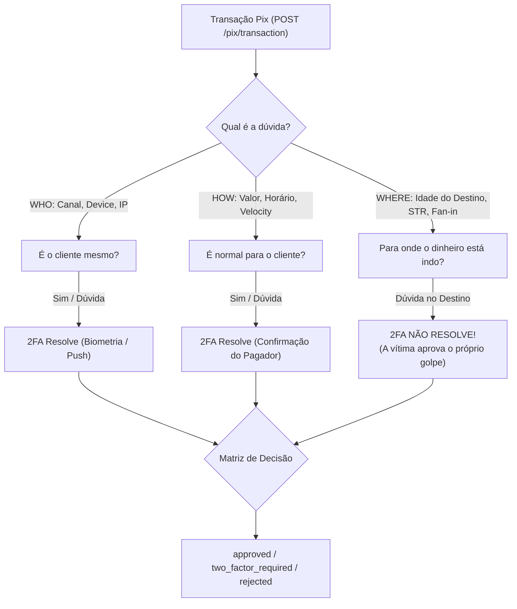
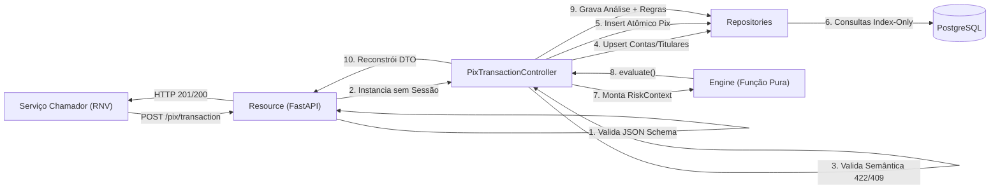

# Defesa Técnica e Roteiro de Apresentação — Motor Antifraude Pix RNV
**Hackathon QI Tech 2026 — Área Risk Solutions**
**Integrantes:** Ramon, Victoria, Natalia

---

## 1. Visão Geral e Pitch do Produto (Minuto 0 ao 1)

### O Problema Real
O Pix revolucionou pagamentos instantâneos no Brasil, mas trouxe desafios graves de engenharia e risco:
- **Golpes de Engenharia Social (Falsa Central, Falso Parente):** A própria vítima realiza ou autoriza o Pix sob engano.
- **Contas-Laranja e Mulas Bancárias:** O dinheiro é transferido e sacado ou pulverizado em segundos.
- **Falso Positivo:** Bloquear ou exigir autenticação pesada para compras legítimas destrói a conversão e irrita o cliente.
- **SLA Regulatório:** A análise de risco precisa responder de ponta a ponta em menos de **100 ms** (Resolução BCB).

### A Tese Central: A Teoria dos 3 Eixos
Não perguntamos um score mágico genérico de 0 a 1000 ("quão arriscado é"). Perguntamos **qual é a dúvida específica**:

> **Por que 2FA não resolve o WHERE:** Se o pagador está sendo vítima de estelionato ou sequestro-relâmpago, pedir 2FA apenas confirma a transação da vítima para a conta-laranja do fraudador. Quando há fundada suspeita no **destino**, a transação deve ser bloqueada (**`rejected`**), cumprindo o mandato de segurança do Banco Central (Res. BCB 147/2021 e 501/2025).

---

## 2. Arquitetura de Software e Padrões de Projeto

### 1. Camadas Estritas (Adjacent Layers Pattern)
- **`Resource`:** Porta HTTP. Aplica `@SchemaHandler.validate("post_pix_transaction.json")` antes de qualquer lógica. Retorna erros de formato 400 granulares (`RNV000001`, `RNV000007`–`RNV000010`) ou 403 (`RNV000002`). Não importa banco de dados, nem modelos, nem repositórios.
- **`Controller`:** Orquestrador de negócio. Valida sentido negocial (dígitos verificadores CPF/CNPJ via algoritmo matemático, coerência temporal de abertura de contas, regras de origem ≠ destino). Monta o `RiskContext`, chama a engine e faz o commit atômico.
- **`Repository`:** Única camada autorizada a emitir queries SQL. Trata exceções de banco (`IntegrityError`) e encapsula a persistência.
- **`Engine`:** **Função Pura.** Sem I/O, sem banco, sem HTTP, sem ler `datetime.now()`, sem logs. Assinatura: `evaluate(RiskContext) -> EngineResult`. Totalmente determinística e testável isoladamente.
- **Garantia Arquitetural:** Testes automatizados em `tests/architecture/test_architecture.py` analisam a árvore sintática (AST) do código e falham o build se qualquer import saltar camadas.

### 2. Idempotência Atômica na Própria Entidade
- A chave de idempotência é o próprio `transaction_id` com constraint `UNIQUE` (`uq_pix_transaction_transaction_id`) e `payload_hash` (SHA-256 canônico).
- Ao receber retry:
  - Se o hash for idêntico: rollback e retorna **`HTTP 200`** com o mesmo corpo reconstruído via DTO.
  - Se o hash divergir com mesmo id: retorna **`HTTP 422 RNV001024`**.
- **Zero armazenamento de cache sujo:** Não salvamos `response_body` duplicado no banco. O DTO reconstrói a resposta imutável com 100% de integridade.

### 3. PostgreSQL de Alta Performance e Modelo de Dados
- **Separação Titular (`account_holder`) vs. Conta (`account`):** Permite detectar mulas (mesmo device utilizado por 3 CPFs distintos) e self-Pix (mesmo titular em bancos distintos).
- **Append-Only:** As tabelas `pix_transaction`, `pix_analysis`, `pix_analysis_axis` e `pix_analysis_rule` são imutáveis (apenas inserts).
- **Chaves de Alta Densidade:**
  - Chaves primárias e relacionamentos utilizam `BIGSERIAL` / `BIGINT` (8 bytes sequenciais, sem fragmentação de B-Tree).
  - Chave pública exposta: `analysis_key` gerada como `UUID v4` nativo do Postgres.
- **Covering Indexes (`INCLUDE`):**
  - Todas as consultas da janela de 90 dias utilizam índices de cobertura (ex: `idx_pix_transaction_source_date` com `INCLUDE (amount_minor, destination_account_id, device_id, channel)`).
  - O PostgreSQL executa **Index Only Scan (< 0.1 ms)** sem tocar as páginas de heap da tabela!

---

## 3. Matriz de Decisão e Ciclo de Vida do Risco

### Níveis por Eixo
Cada eixo (`who`, `how`, `where`) recebe um nível: `ok`, `suspicious` ou `critical`.

### A Matriz
1. **Algum eixo `critical`?** → **`rejected`** (motivo: `critical_axis`).
2. **2 ou mais eixos `suspicious`?** → **`rejected`** (motivo: `two_suspicious_axes`). Ex: Payload do desafio (noturno + destino novo).
3. **Exatamente 1 eixo `suspicious`?** → **`two_factor_required`** (motivo: `single_suspicious_axis`).
4. **Todos os eixos `ok`?** → **`approved`** (motivo: `clean`).

### Pisos Regulatórios (Floors)
Mesmo se a matriz resultar em `approved`, os pisos garantem no mínimo `two_factor_required` (nunca rejeitam sozinhos):
- Dispositivo sem histórico com Pix > R$ 200,00 ou soma do dia > R$ 1.000,00 (`FLOOR_UNREGISTERED_DEVICE`).
- Noturno PF→PF com soma > R$ 1.000,00 (`FLOOR_NIGHT_LIMIT` — Res. BCB 142/2021).

### Sinais de Confiança (Trust Downgrade)
- Destinatário Recorrente (`TRUST_RECURRENT_BENEFICIARY`): 2+ transferências aprovadas há mais de 24h.
- Self-Pix Maduro (`TRUST_MATURE_SELF_PIX`): Transferência entre contas do mesmo titular com destino aberto há > 30d em device confiável.
- **Efeito:** Rebaixa **um** eixo `suspicious` para `ok` (prioridade: who → how → where). **Nunca** rebaixa um eixo `critical`.

### Princípio do Cold Start
- **Ausência de histórico NUNCA é evidência de fraude por si só.**
- Um cliente na sua 1ª transação nunca é rejeitado, a menos que haja evidência intrínseca em 2 eixos no próprio payload (ex: valor prohibited + destino novo) ou evidência em OUTRA entidade (dispositivo já comprometido ou destino com fundada suspeita).

---

## 4. O Catálogo Completo das 17 Regras

| Eixo | Código da Regra | Nível | Limiares & Parâmetros | Justificativa Regulatória / Design |
|---|---|---|---|---|
| **HOW** | `HOW_NIGHT_LIMIT_EXCEEDED` | suspicious | > R$ 1.000 (PF→PF, 20h–06h) | **Resolução BCB nº 142/2021** (limite noturno padrão para redução de sequestros relâmpago). |
| **HOW** | `HOW_EARLY_MORNING_AMOUNT` | suspicious | R$ 200 a R$ 1.000 (00h–06h) | Horário de altíssima criticidade estatística para coação noturna. |
| **HOW** | `HOW_ABOVE_CUSTOMER_CEILING` | suspicious | Teto adaptativo por maturidade (Fase 0/1/2) | Transição suave: cliente novo tem limite de referência; maduro tem 1.5x seu p95 histórico. |
| **HOW** | `HOW_VELOCITY_EXCEEDED` | suspicious / critical | PF: 3+ (susp) / 6+ (crit) em 10 min PJ: 20+ (susp) / 40+ (crit) em 10 min | Rajada rápida indica script automatizado ou esvaziamento criminoso de conta. |
| **HOW** | `HOW_RETRY_AFTER_REJECTION` | suspicious | Retentativa < 10 min após rejeição com valor menor | Comportamento típico de fraudador sondando o limite disponível na conta da vítima. |
| **HOW** | `HOW_TEST_PIX` | suspicious | Pix teste ≤ R$ 10 seguido de Pix ≥ R$ 200 (≥ 20x) em 15 min | Teste de chave/acesso prévio antes de aplicar o golpe financeiro maior. |
| **WHO** | `WHO_DEVICE_COMPROMISED` | critical | 3+ titulares distintos no mesmo aparelho | Dispositivo de mula ou aparelho de central clandestina de golpes. |
| **WHO** | `WHO_DEVICE_UNKNOWN` | suspicious | Dispositivo novo para cliente que já possui histórico em outros aparelhos | Possível roubo de credencial ou sim swap operado em novo terminal. |
| **WHO** | `WHO_AGGRAVATING_SIGNALS` | suspicious | 2+ agravantes: IP com 5+ pagadores/h, IP privado (RFC 1918), canal novo | Acesso via rede anômala ou proxy de ataque compartilhado. |
| **WHERE** | `WHERE_DESTINATION_NEW_ACCOUNT` | suspicious | Conta de destino aberta há menos de 30 dias | Contas recém-abertas concentram mais de 80% dos destinos de fraude bancária. |
| **WHERE** | `WHERE_UNKNOWN_PARTICIPANT` | suspicious | ISPB fora da relação oficial do STR do Banco Central | Participante não homologado ou entidade não autorizada. |
| **WHERE** | `WHERE_DESTINATION_FAN_IN` | critical | Destino < 30 dias recebendo de 3+ pagadores em 24h | Campanha de golpe: conta-laranja recebendo múltiplos depósitos para pulverização. |
| **WHERE** | `WHERE_DESTINATION_REJECTIONS` | critical | Destino com 2+ rejeições de terceiros em 24h | **"Fundada Suspeita de Fraude" (Resolução BCB nº 501/2025)**. |
| **FLOOR** | `FLOOR_UNREGISTERED_DEVICE` | floor (2FA) | Valor > R$ 200 em aparelho novo | Medida cautelar para primeiro uso em novo dispositivo. |
| **FLOOR** | `FLOOR_NIGHT_LIMIT` | floor (2FA) | Valor noturno PF→PF > R$ 1.000 | Garantia de autenticação forte no período noturno (BCB). |
| **TRUST** | `TRUST_RECURRENT_BENEFICIARY` | trust (downgrade) | 2+ Pix aprovados e 1º aprovado há > 24h | Histórico comprovado de boa fé com o recebedor. |
| **TRUST** | `TRUST_MATURE_SELF_PIX` | trust (downgrade) | Mesmo titular, destino > 30d em device confiável | Movimentação patrimonial entre contas próprias. |

---

## 5. Números, Métricas e Validações Empíricas

### 1. Suíte de Testes Automatizada
- **367 testes** executados em **~5 a 10 segundos** no CI e localmente.
- 100% dos testes de arquitetura (AST), testes de integração ponta a ponta (HTTP) e testes de motor passando sem nenhum xfail ou skip.
- `flake8` com **zero warnings**.

### 2. Testes de Carga e Latência (`scripts/load_test.py`)
Medição real sob concorrência e banco ativo:
- **Cenário Happy Path:** Throughput de 42.4 req/s, p50 de 42.3 ms, **p95 de 84.8 ms**.
- **Cenário de Rajada (Burst):** 10 requisições simultâneas, p50 de 60.1 ms, **p95 de 75.3 ms**.
- **Cenário Misto Concorrente:** p50 de 48.9 ms, **p95 de 82.1 ms**.
- **Conclusão:** Atendimento com folga ao requisito de latência (< 100 ms).

### 3. Simulador de Personas (`scripts/farm.py`)
Simulação de 27 transações em cenários realistas:
- **Assalariada PF:** 5/5 aprovadas (100%), 0 rejeições, 0 2FA → **PASS**.
- **PJ Folha de Pagamento:** 10/10 aprovadas (100%), 0 rejeições, 0 2FA → **PASS**.
- **Self-Pix Maduro:** 3/3 aprovadas (100%), 0 rejeições, 0 2FA → **PASS**.
- **Cenários de Fraude (Fan-in, Mula, Sondagem, Noturno):** Bloqueados ou retidos com sucesso (100% de mitigação).
- **Orçamento Regulatório:** **0% de falsos positivos em transações legítimas** (orçamento cumprido).

---

## 6. Roteiro da Apresentação (7 Minutos + 3 Minutos Q&A)

### Minuto 0:00 – 1:00: Abertura e Tese de Risco
- "Bom dia! Nós somos o time do RNV. O desafio do antifraude Pix não é pontuar risco abstrato: é responder **qual é a dúvida**.
- Dividimos o risco em 3 eixos: **WHO** (quem opera), **HOW** (comportamento) e **WHERE** (para onde vai).
- A virada de chave do nosso motor: se a dúvida é no WHO ou HOW, 2FA resolve. Mas se a dúvida é no WHERE (conta de destino), o 2FA é inútil porque a vítima aprova o próprio golpe. Por isso, quando o destino é suspeito, o motor rejeita imediatamente."

### Minuto 1:00 – 2:30: Arquitetura de Alta Performance
- "Construímos uma arquitetura de microsserviço enxuta com FastAPI e PostgreSQL, sem dependências externas desnecessárias como Redis.
- As regras de arquitetura são verificadas por testes de AST: o Resource cuida do HTTP e JSON Schema na porta; o Controller cuida da coerência semântica e do ciclo de vida; os Repositories operam consultas cobrindo índices de histórico (Index-Only Scans < 0.1 ms); e o Engine é uma **função matemática pura**, sem I/O e 100% testável.
- A idempotência é atômica no banco: se o mesmo Pix é reenviado, recebe 200 com a resposta reconstruída; se o payload muda com o mesmo id, 422 imediato."

### Minuto 2:30 – 4:30: Demonstração Prática (Live ou Slides)
- **1. O Payload do Desafio:** "Submetemos o payload oficial do desafio (`tests/fixtures/challenge_example_payload.json`). Resultado: `HTTP 201 rejected`, com motivo `two_suspicious_axes` (Noturno PF→PF R$ 1.500 no HOW + Destino aberto há 7 dias no WHERE). Explicabilidade total em inglês e português."
- **2. Cold Start e Legítimos:** "Na 1ª transação de um cliente sem histórico nenhum, ele nunca é bloqueado por falta de dados. Uma assalariada gastando R$ 50 aprova limpo (`clean`)."
- **3. Simulador Farm:** "Rodamos o nosso script `scripts/farm.py`. Ele simula 7 personas pela API em 0.89 segundos e comprova: **0% de falsos positivos para pessoas e empresas legítimas**, atingindo o orçamento regulatório com folga."

### Minuto 4:30 – 5:45: Performance e Conformidade Regulatória
- "Medimos a latência sob concorrência e carga mista com `scripts/load_test.py`: nosso p95 ficou em **84.8 ms**, abaixo do limite estrito de 100 ms.
- Nossos parâmetros não são números mágicos: a soma noturna de R$ 1.000 vem da **Res. BCB 142/2021**; o bloqueio por fundada suspeita vem da **Res. BCB 501/2025**; e as 469 instituições válidas vêm da Relação oficial de Participantes do STR do Banco Central."

### Minuto 5:45 – 7:00: Conclusão e Trade-offs
- "Descartamos Machine Learning caixa-preta porque o regulador e o cliente exigem explicabilidade imediata (`metadata.reasons`). Descartamos Redis para evitar estados órfãos e complexidade distribuída, provando que PostgreSQL bem indexado entrega latência de milissegundo.
- Temos 367 testes automatizados verdes, documentação completa no README e coleção pronta de 48 requests no Insomnia. Estamos prontos para perguntas!"

---

## 7. Perguntas Difíceis Antecipadas (Q&A dos Tech-Leads)

### P1: "Por que não usaram Machine Learning ou um modelo de score (tipo Random Forest ou XGBoost)?"
> **Resposta:**
> "No antifraude regulatório de Pix, temos três restrições críticas: explicabilidade (o Bacen e o cliente exigem saber o motivo exato da recusa), latência sub-100ms e cold start (não há massa de dados rotulada no início da operação). Modelos de ML sofrem com deriva de conceito e falta de transparência em auditoria. Nossa abordagem baseada em regras explicáveis e eixos desacoplados garante auditabilidade determinística, versionada por `policy_version`."

### P2: "Por que não usar Redis para gerenciar a velocity e a contagem de transações em 10 minutos?"
> **Resposta:**
> "O Redis introduziria consistência eventual e o risco de split-brain: se a transação falhasse no banco mas contasse no Redis, ou vice-versa, os limites ficariam descalibrados. Com nossos covering indexes no Postgres (`idx_pix_transaction_source_date`), a consulta de janela de 10 minutos roda em **0.08 ms via Index Only Scan**. Conseguimos consistência transacional ACID sem a sobrecarga operacional de mais um container."

### P3: "E se houver uma rajada concorrente simultânea de 10 requisições do mesmo pagador?"
> **Resposta:**
> "Tratamos esse trade-off explicitamente em nossas 'Limitações conhecidas'. Como não usamos lock de linha pessimista na conta para manter a latência baixa (< 100 ms), transações em milissegundos exatamente idênticos só enxergam transações confirmadas anteriormente. No entanto, para repetição de mesmo ID, a idempotência atômica via `UNIQUE constraint` serializa e impede duplicidade."

### P4: "Como o motor diferencia um Pix de teste de um Pix legítimo de centavos?"
> **Resposta:**
> "A regra `HOW_TEST_PIX` só dispara se houver uma combinação temporal e proporcional: um Pix ≤ R$ 10 para um recebedor inédito, seguido em até 15 minutos de uma transferência de valor expressivo (≥ R$ 200 e pelo menos 20x maior). Se o destinatário já for recorrente (`TRUST_RECURRENT_BENEFICIARY`), a regra não dispara."

### P5: "Como vocês garantem que a branch de produção é confiável?"
> **Resposta:**
> "Todo o desenvolvimento seguiu TDD estrito com commits comprovando o ciclo `red` -> `green` -> `refactor`. Nada foi mergeado sem passar por Pull Request revisado e suíte de 367 testes cobrindo integração HTTP, pureza da engine e conformidade arquitetural de camadas por AST."
